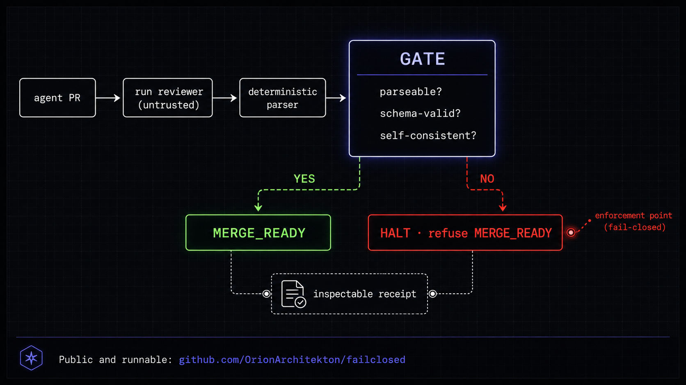

# failclosed


Fail-closed merge admission control for agent-written code.



## The problem

AI coding agents write and merge code faster than review can govern it. Most
LLM-review tools relay the model's own verdict: when the model says "looks
good," the change is treated as mergeable. That is advisory governance. It fails
open. When the reviewer's output is truncated, malformed, or self-contradictory
— for example, a `fix` verdict where no finding cites a file — an advisory tool
defaults to letting the merge through. The reviewer becomes a single point of
silent failure precisely when its output is least trustworthy.

## What failclosed does

failclosed runs an LLM reviewer and then refuses to trust its verdict. The
reviewer output passes through a hardened parser, and a gate **refuses to report
`MERGE_READY`** when the output is:

- unparseable,
- schema-invalid, or
- self-contradictory (a `fix` verdict with no finding citing a file).

Enforcement precedes the merge decision. When the review cannot be deterministically
evaluated, the merge does not proceed. That is the whole point: a merge that can
proceed when governance cannot be evaluated is not governed.

It runs one path, with no advisory fallback:

1. **Wait for review bots**, then fetch and classify their threads.
2. **Run the reviewer** (standard pass, then an adversarial pass) through a
   configurable command seam.
3. **Parse** the output through the multi-shape parser.
4. **Fail-closed gate**: any unparseable / schema-invalid / contradictory result
   becomes a `parse_error`, which blocks `MERGE_READY`.
5. **Emit fix requests** (structured; the agent applies them — failclosed does
   not edit code inline).
6. **Resolve bot threads** via the GitHub GraphQL API.
7. **Report** `MERGE_READY`, `FINDINGS_REMAIN`, or `THREADS_UNRESOLVED`.

## The reviewer seam

The reviewer is a command, not a vendor. `reviewer_command` receives the review
prompt on **stdin** and returns the reviewer output on **stdout**. The parser
accepts structured JSON, JSON embedded in prose, or rendered native text, so any
command that honors the contract works:

```toml
reviewer_command = "codex exec --json -"
```

The product is not the reviewer. The product is the gate that distrusts it.

## Quickstart

Requires Python 3.9+ and the `gh` CLI (authenticated). Reviewer overrides via
`failclosed.toml` require Python 3.11+.

```bash
git clone https://github.com/OrionArchitekton/failclosed
cd failclosed

# Optional: override defaults (reviewer command, thresholds, trunk branches).
cp failclosed.toml.example failclosed.toml

# Describe the push in a small context JSON.
cat > ctx.json <<'JSON'
{ "repo_root": "/path/to/your/repo", "branch": "feature-x", "sha": "abc1234" }
JSON

python run_review_pipeline.py --context ctx.json --json
```

`--dry-run` runs without writing fixes or resolving threads. `--non-blocking`
returns `BOTS_PENDING` immediately when the push is younger than the bot-wait
window instead of sleeping.

## Wiring it in

Write the context JSON from a `post-push` git hook or a GitHub Action after a
push to a PR branch, then invoke failclosed. The deterministic status is the
signal a merge gate consumes: `MERGE_READY` is the only status that clears the
gate.

## Configuration

All keys are optional and self-contained; see
[`failclosed.toml.example`](failclosed.toml.example). No file outside the repo
is required to run.

## Status codes

| Status | Meaning |
|---|---|
| `MERGE_READY` | Reviewer output parsed and clean; no open fixes or threads. |
| `FINDINGS_REMAIN` | Fixes outstanding, or a review phase failed to evaluate (fail-closed). |
| `THREADS_UNRESOLVED` | Bot review threads still open. |
| `BOTS_PENDING` | Push too recent for bots to have landed (non-blocking mode). |

## Three-way fix proof

`three_way_proof.py` holds a bug fix to a stricter bar than "the test passes".
A fix only counts when its regression test:

1. **fails before** the fix,
2. **passes after** the fix,
3. **fails again** when the fix is reverted,

and prints a ran-marker, the line `THREEWAY-RAN:<test-id>`, in every run, plus a
pass-marker, `THREEWAY-PASS:<test-id>`, as its last step. A test that never
failed proves nothing. A test that never ran (wrong selector, skipped, not
collected) can look exactly like a failure. A pass that survives the revert came
from run order or leftover state, not from the fix. A failure that belonged to
another test in the same run is not this test failing. Each of those is
rejected.

```python
def test_add_handles_positive_numbers():
    print("THREEWAY-RAN:add-positive")   # after imports and setup
    assert add(2, 3) == 5
    print("THREEWAY-PASS:add-positive")  # last: only reached when the test passes
```

```bash
python three_way_proof.py --fix HEAD --test-id add-positive --fail-exit-code 1 \
  -- python -m pytest -q -rA tests/test_calc.py::test_add_handles_positive_numbers
```

- `--fix REV` compares the fix with its parent. `--base REV` sets the base
  explicitly: required for merge and root commits, and how you prove a whole
  branch (`--base "$(git merge-base main HEAD)" --fix HEAD`). The base must be
  an ancestor of the fix. `--base REV --fix-diff PATCH` takes the fix as a patch
  file instead.
- Changed files split into test paths, kept at the fix version in every leg, and
  fix paths, which are what gets reverted. The defaults cover common test files
  and directories plus test data (`testdata/`, `fixtures/`, `__snapshots__/`,
  `*.golden`, `*.snap`, and similar); `--test-path GLOB` (repeatable) replaces
  them. Calling a fix file a test can only make a proof fail. Calling a test
  file fix code is the dangerous direction (rewriting an expected output would
  then count as the fix), so check the `fix code` line of the summary: every
  path there should be production code.
- Each leg runs in its own fresh checkout of a throwaway clone with git hooks
  disabled. Your repository and working tree are not touched.
- Both markers must be whole output lines, so a runner echoing the test source
  in a traceback does not count. With pytest, use `-rA` so passing tests show
  their output (or `-s`, printing each marker after a newline).
- The pass-marker ties each outcome to the marked test: a failing leg that
  printed it, or a passing leg that did not, is not proven.
- `--fail-exit-code N` counts only exit `N` as a failure (1 for pytest, which
  rules out collection and usage errors). `--timeout SECONDS` bounds each leg.
- `--json` prints a machine-readable receipt; without it you get a short summary
  you can paste into a PR description. Captured output shows the throwaway
  checkout as `<scratch>` and your home directory as `~`.

| Verdict | Exit | Meaning |
|---|---|---|
| `PROVEN` | 0 | All three legs met their expectation, each with the right markers. |
| `NOT_PROVEN` | 1 | A leg missed its expectation, lacked a marker, timed out, or was killed. |
| `ERROR` | 2 | The proof could not be evaluated: invalid input (including `--help`), nothing to revert, a patch that does not apply, a tree that cannot be built exactly, or an internal error. |

For a commit or range, the `reverted` leg checks out the same code as `before`.
It runs after the passing leg, so it shows the pass came from the fix and not
from run order or from state left outside the checkout.

Limits a reviewer still covers: a test that fails for a reason other than the
bug (calling a function only the fix adds, say) still fails its leg; a test
helper outside the default conventions counts as fix code unless `--test-path`
names it; a flaky test can pass all three legs by chance; and a test written to
game its own markers defeats the proof, so the test itself still gets read. For
a parametrized test, select the case that reproduces the bug or print a per-case
id (`THREEWAY-RAN:add[negative]`).

## Tests

```bash
pip install pytest
pytest -q
```

---

failclosed is a narrow, runnable demonstration of one principle: governance
evaluated deterministically, before state mutation, in a fail-closed
configuration — applied here to the merge boundary. The same enforcement model,
applied across an enterprise agent stack, is a
[Runtime Governance Readiness Scan](https://danmercede.com).
